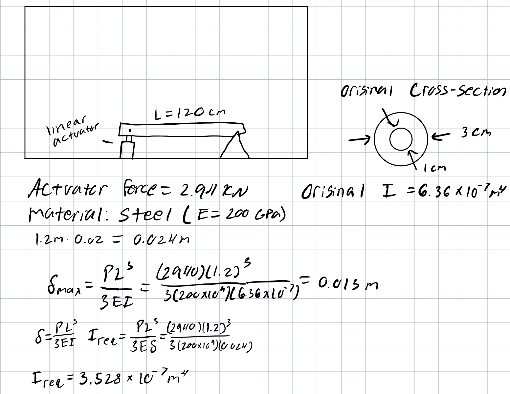

For this project, I was tasked with designing a two-dimensional mechanical system consisting of a rigid rod, three pin connections, and a linear actuator. The objective was to determine the optimal geometric configuration that maximized the lifting force generated by the actuator.

I selected a rod length of 120 cm (the maximum allowable length) and used a RSX linear actuator capable of exerting a maximum force of 2.94 kN. The design involved strategically positioning the three pins—one fixed ground point, one pivot at the actuator base, and one at the rod’s upper end—to maximize mechanical advantage and vertical lift at the free end.

The project required applying static equilibrium principles to analyze forces, moments, and reaction components at each pin joint. By adjusting the actuator’s mounting angle and pin locations, I determined the configuration that achieved the greatest lifting force while maintaining structural balance and realistic design constraints.

This project demonstrated my ability to translate theoretical statics principles into a practical mechanical design and strengthened my understanding of force transmission, moment analysis, and actuator geometry.

I modeled the beam as a cantilever with a 2.94 kN tip load from the actuator. I calculated the required second moment of area to keep the tip deflection below the allowable limit of 2% of the beam’s 1.2 m length (24 mm).
I evaluated several cross-sections and found that a hollow circular tube is the most mass-efficient way to achieve the required bending stiffness. The final recommended design is an 30 mm outer-diameter hollow steel tube with a wall thickness of about 20 mm. This section meets the deflection requirement while minimizing mass far better than an equivalent solid bar.